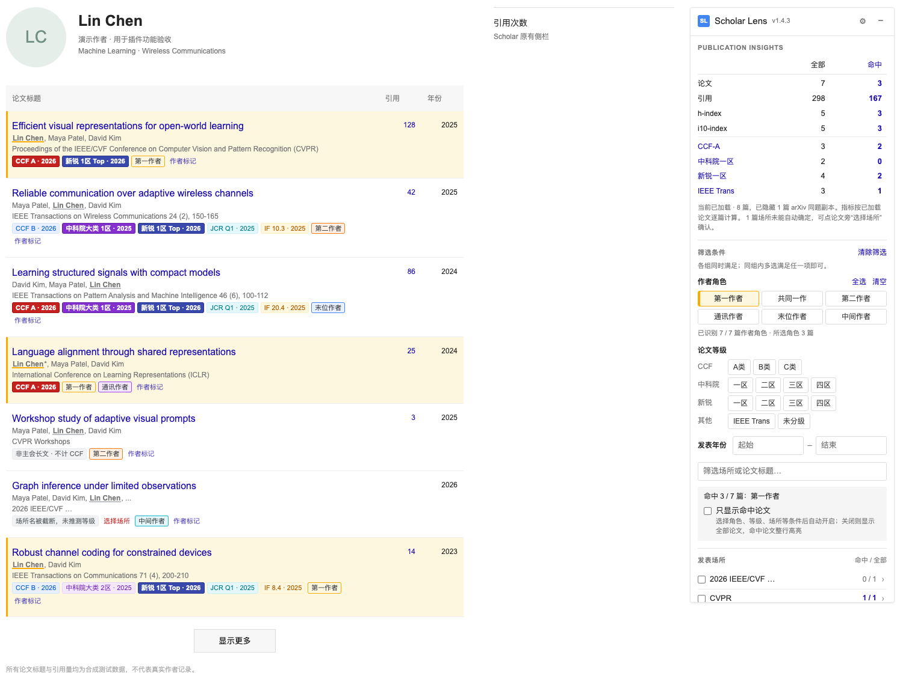

<div align="center">


# Scholar Lens · 学术全景

**在 Google Scholar 上直接看到每篇论文的 CCF、中科院、新锐、JCR 和 IF，并按作者角色筛选、统计和导出。**

A local-first Chrome extension that annotates Google Scholar with venue rankings (CCF, CAS, XR, JCR, IF) and author roles.

[](https://github.com/tangshunpu/shcholar-lens/releases/latest)


[功能](#功能) · [安装](#安装) · [使用](#使用) · [数据来源](#数据来源) · [开发](#开发) · [更新日志](CHANGELOG.md)

</div>



<sub>截图中的论文、作者和引用数是合成测试数据；期刊与会议指标来自内置快照。</sub>

## 功能

- **论文等级标签**：每篇论文旁显示 CCF 2026、中科院 2025 大类分区、新锐 2026、JCR 2025 和 IF 2025。CCF-A、中科院一区、新锐一区用醒目配色；悬停可看全部大小类、Top 标记、年份、来源与原始数据行。
- **作者角色识别**：自动读取主页上的英文姓名并生成首字母缩写（`Yinghui He` → `Y He`，兼容 `GY Li`、`G. Y. Li` 等写法），标出第一、第二、末位和中间作者；姓名后带 `*` 时识别为通讯作者。共同一作等其他角色可用“作者标记”逐篇确认。名单里出现另一个可用同一缩写的完整姓名时，暂停自动匹配，不靠猜。
- **组合筛选**：按作者角色、论文等级、发表年份、场所和标题关键词筛选；不同组之间为“且”，同组多选为“或”。命中论文整行高亮，也可以只显示命中论文。
- **Publication Insights**：“全部 / 命中”两列统计论文数、引用、h-index、i10-index，以及 CCF-A、中科院一区、新锐一区、IEEE Trans 篇数，点击即可筛选。
- **场所识别**：1,290 种别名写法覆盖 388 个场所（如 NIPS / NeurIPS、Oakland / IEEE S&P）。还能识别被截断的名称、IEEE Xplore 旧式倒装名（`Communications Letters, IEEE`）、ISO 4 缩写（`IEEE Commun. Mag.`）和 DOI 中的期刊代码。无法唯一确定时显示“选择场所”，由你确认，不强行赋级。
- **自动加载与导出**：自动点击“显示更多”加载全部论文；隐藏已有正式版本的 arXiv 副本；当前列表可导出为 CSV，包含指标、来源和是否命中。
- **本地优先**：数据随扩展打包，安装即用。只申请 `storage` 权限，没有服务器、第三方 API、遥测或运行时依赖。

## 安装

Scholar Lens 目前不在 Chrome 应用商店上架，需要以“已解压的扩展程序”方式加载。支持桌面版 Chrome 111 及以上，以及 Edge 等 Chromium 内核浏览器。

1. 从 [Releases](https://github.com/tangshunpu/shcholar-lens/releases/latest) 下载最新的 `scholar-lens-v*.zip` 并解压，得到 `scholar-lens` 文件夹（也可以直接 `git clone` 本仓库）。把它放在不会被移动或删除的位置，浏览器会一直从这里加载。
2. 打开 `chrome://extensions/`（Edge 为 `edge://extensions/`），开启“开发者模式”。
3. 点击“加载已解压的扩展程序”，选择里面直接有 `manifest.json` 的那一层文件夹。
4. 打开或刷新任一 Google Scholar 作者主页或搜索结果页，右侧出现 Scholar Lens 面板即安装成功。

**更新**：用新版文件覆盖原文件夹，在扩展管理页点击“重新加载”，再刷新 Scholar 页面。保持原路径即可保留设置、已确认的场所和作者标记。

> [!NOTE]
> Chrome 启动时可能提示“停用开发者模式扩展程序”，选择保留即可。所有非商店扩展都会出现这个提示。

支持 28 个 Google Scholar 域名（`scholar.google.com`、`.com.hk`、`.cn`、`.co.uk` 等），完整列表见 [`manifest.json`](manifest.json)。

## 使用

- **作者主页**：自动读取主页英文名、加载全部论文并标注。展开面板里的“姓名与可能缩写”可查看和勾选候选写法，反序写法（如 `He Y`）需手动勾选；其他写法可在“作者姓名与识别规则”中每行补充一个。
- **搜索结果页**：同样显示等级标签。作者高亮只使用你填写的姓名；搜索页不自动翻页。
- **确认作者角色**：点击论文旁的“作者标记”手动指定角色（如共同一作、通讯作者），只保存在本机。
- **确认场所**：点击“选择场所”，从候选中选择，或按全称、缩写、ISSN 搜索整个目录，也可标为“不在目录中”。同名场所的所有论文一起生效。
- **设置页**：点击扩展图标 →“数据管理与偏好设置”，可搜索内置期刊、查看来源、调整偏好（自动加载、arXiv 去重等）或导入补充数据。

### 与其他扩展共存

与 Google Scholar Publication Venue Stats 0.1.15、Author Highlighter 2.4.0 同时启用时，Scholar Lens 会收起它们重复的面板和开关，同步 Author Highlighter 的角色勾选，并统一整行高亮；关闭 Scholar Lens 后恢复原样。Venue Stats 的自定义配置不会自动迁移，可复制到本扩展的设置页。

## 数据来源

| 数据 | 版本 | 覆盖 |
|---|---|---|
| CCF | 第七版 2026（2026-04-09 修订） | 677 个场所，10 个领域 |
| 中科院分区 | 2025 升级版 | 内置 8,154 个期刊（原表 21,772） |
| 新锐分区 | 2026（2026-03-24 发布） | 内置 8,404 个期刊（原表 22,299）+ 15 个计算机会议 |
| JCR | 2025 指标年度 | 20,337 个期刊有 Q1–Q4 |
| IF | 2025 指标年度（2026 年发布） | 22,594 个期刊有数值或 `<0.1` |

- 期刊数据来自 [ShowJCR 固定版本](https://github.com/hitfyd/ShowJCR/tree/4687a8f608f20aaf004299992f5d347dba009361)，是第三方公开快照，**不是官方实时接口，也不保证无遗漏或错误**。CCF 目录整理自官方公开 PDF。来源、交叉核验和重建方法见 [docs/SOURCES.md](docs/SOURCES.md)。
- 为控制体积，医学与人文社科期刊只保留名称与 ISSN，不含指标；保留名称是为了不让这些论文被套到名称相近的理工期刊上。全部 CCF 期刊保留完整指标。需要时可通过补充导入添加。
- 新锐分区单独显示，不当作中科院分区，也不用来推断其他指标。

## 识别规则与局限

- 标签使用各指标最新可用年度，不回溯为论文发表当年的等级或分区。
- 只根据发表场所字段匹配，不从论文标题猜测。歧义缩写（如单独的 `FSE`、`WWW`）、同名不同刊、截断后不唯一的名称不强行赋级。
- Workshop、Findings、短文、Demo、Companion 不套用主会等级；CCF 单独列出的 Workshop（如 HotOS）保留自己的等级。
- 不用 SJR / CiteScore 代替 IF；缺失值保持缺失，`<0.1` 不转换为 0。
- 姓名匹配无法区分完全同名的作者；作者名单被截断（`…`）时不推断末位作者。
- “全部”列的引用、h-index、i10-index 直接读取 Scholar 官方统计；“命中”列按已加载论文逐篇计算，两者口径不同。

## 补充导入

内置数据开箱即用，导入不是必需的。如需添加其他年度、修正数据，或补充医学与人文社科期刊的指标，可在设置页导入 UTF-8 CSV、TSV 或 JSON（Excel 请另存为 CSV UTF-8）。导入前先校验和预览，失败时保留原数据；单文件最多 8 MB / 40,000 条。字段说明见 [docs/DATA_FORMAT.md](docs/DATA_FORMAT.md)。

## 开发

无需构建，也不需要 `npm install`。

```bash
npm test          # 核心单元测试（Node.js 20+）
npm run check     # manifest、打包文件与 JS 语法检查
```

浏览器端检查用 Playwright 把扩展加载到隔离的 Chromium，在离线的 Scholar 页面样本上运行：

```bash
npm run test:browser   # 等级标签、筛选、导入导出、搜索页、弹窗
npm run test:authors   # 作者姓名与角色匹配
npm run test:layout    # 面板布局与 Scholar 原有居中
npm run test:loading   # 自动加载全部论文
npm run test:compat    # 与旧扩展共存，需设置 LEGACY_HIGHLIGHTER 与 LEGACY_VENUE_STATS
```

可用 `PLAYWRIGHT_MODULE` 指向已有的 Playwright 安装，`CHROME_EXECUTABLE` 指定浏览器，`SCHOLAR_QA_OUTPUT` 指定截图与结果的输出目录。验证记录见 [docs/VALIDATION.md](docs/VALIDATION.md)。未对线上 Scholar 做自动化端到端测试，以免触发 Google 的异常流量验证。

从随包原始文件重建数据：

```bash
python3 scripts/build-journals.py         # 由 data/upstream 生成 journals.json
python3 scripts/build-journals.py --all   # 同上，保留医学与人文社科期刊的指标
python3 scripts/build-aliases.py          # 生成 venue-aliases.json
```

### 项目结构

```text
scholar-lens/
├── manifest.json
├── src/
│   ├── content.js           # 页面面板、标注与筛选交互
│   ├── core.js              # 场所匹配、作者角色、统计、导入导出
│   ├── catalog.js           # 合并 CCF、期刊数据与别名目录
│   ├── venue-normalizer.js  # 场所名归一化（来自 Venue Stats 0.1.15）
│   ├── background.js        # 读取内置数据
│   └── popup.* / options.*  # 弹窗与设置页
├── data/
│   ├── ccf.json             # CCF 2026 目录
│   ├── journals.json        # 中科院 / 新锐 / JCR / IF 快照
│   ├── venue-aliases.json   # 场所别名与关联
│   └── upstream/            # ShowJCR 原始 CSV
├── scripts/                 # 数据重建与浏览器检查
├── tests/                   # 单元测试与样本
└── docs/                    # 数据格式、来源与验证记录
```

## 许可与致谢

- 期刊数据来自 [ShowJCR](https://github.com/hitfyd/ShowJCR)，遵循 GPL-3.0；原始 CSV、转换程序和许可全文随包提供，见 [NOTICE.md](NOTICE.md) 与 [`licenses/`](licenses/)。
- 新锐期刊分区表由 [xr-scholar.com](https://www.xr-scholar.com) 发布。
- CCF 目录整理自中国计算机学会官方公开 PDF，不代表 CCF 认可本扩展。
- `src/venue-normalizer.js` 来自 Google Scholar Publication Venue Stats 0.1.15。

本项目与 Google、CCF、Clarivate、ShowJCR 均无隶属关系。
